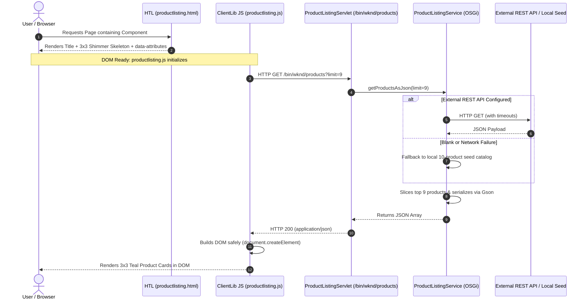

# AEM Technical Assessment & Component Showcase

> **Adobe Experience Manager (AEM as a Cloud Service / AEM 6.5+)**  
> **Candidate Implementation Repository**  
> **Tech Stack:** Java 11/21, OSGi R7, Apache Sling Models, HTL (Sightly), Coral UI 3, BEM CSS, Vanilla ES6 JavaScript, JUnit 5 + AEM Mocks.

---

## Table of Contents
1. [Overview & Deliverables](#1-overview--deliverables)
2. [Component 1: Product Listing 3x3 Grid](#2-component-1-product-listing-3x3-grid-component)
   - [Architectural Design](#architectural-design)
   - [Hardcoded vs. URL Strategy](#hardcoded-vs-url-strategy)
   - [Dialog & Sling Model Configuration](#dialog--sling-model-configuration)
3. [Component 2: High-Performance Image Carousel](#3-component-2-high-performance-image-carousel-component)
   - [Architectural Overview & Core Extension](#carousel-architectural-overview)
   - [Authoring Restrictions & Defensive Limits](#authoring-restrictions--defensive-limits)
   - [High-Resolution Asset Performance Mitigation (>4 MB)](#high-resolution-asset-performance-mitigation-4-mb)
   - [Core Web Vitals & Accessibility (WCAG 2.1)](#core-web-vitals--accessibility-wcag-21)
4. [Automated Testing Suite (JUnit 5 + AEM Mocks)](#4-automated-testing-suite)
5. [Build, Deployment & Verification](#5-build-deployment--verification)
6. [Repository & Module Structure](#6-repository--module-structure)

---

## 1. Overview & Deliverables

This repository contains production-ready AEM implementations for two business requirements designed with enterprise-grade best practices:

| Component | Resource Type | Core Objective | Key Differentiators |
| :--- | :--- | :--- | :--- |
| **Product Listing** | `wknd/components/productlisting` | Renders a responsive 3×3 grid of product cards consumed asynchronously. | OSGi Service + Sling Servlet BFF proxy; resilient seed fallback; Coral UI 3 grid presets (`3x3`, `3x2`, `2x2`, `custom`); 100% XSS-immune DOM creation. |
| **High-Performance Carousel** | `wknd/components/carousel` | Image carousel with authorable DAM assets and high-res asset handling. | Extends Core Carousel; 8-slide defensive ceiling; eager LCP on slide 1, lazy loading on slides 2..N; responsive WebP `srcset`; CSS `aspect-ratio` CLS prevention; WCAG 2.1 compliance. |

---

## 2. Component 1: Product Listing 3x3 Grid Component

### Architectural Design



### Hardcoded vs. URL Strategy
* **Why Hardcoding in Servlets is an Anti-Pattern:** Violates the Single Responsibility Principle (SRP) and requires a full code deployment just to update product listings or prices.
* **Why Relying Exclusively on External URLs is Risky:** Network downtime, rate limiting, and browser CORS restrictions can break the frontend.
* **The Enterprise Solution:** A **Resilient Strategy Pattern**:
  1. The OSGi Service (`ProductListingService`) manages HTTP connections with configurable connect/read timeouts.
  2. If the external endpoint is blank or fails, it **automatically falls back to the seed catalog** (10 items), preventing white screens or broken markup.
  3. The Sling Servlet acts as a **Backend-For-Frontend (BFF) proxy** mounted at `/bin/wknd/products` and `wknd/components/productlisting.products.json`, eliminating CORS hurdles while enabling AEM Dispatcher caching.

### Dialog & Sling Model Configuration
* **Coral UI 3 Dialog (`_cq_dialog`):**
  * **Grid Layout Presets:** `3x3 Blocks (9 Products - Default)`, `3x2 Blocks (6 Products)`, `2x2 Blocks (4 Products)`, and `Custom`.
  * **Data Source Switcher:** Toggle between OSGi Service endpoint and custom REST endpoint.
* **Sling Model (`ProductListingModel`):**
  * Reads authored JCR values, injects `ProductListingService`, and exposes computed CSS grid rules (`grid-template-columns: repeat(3, 1fr)`).

---

## 3. Component 2: High-Performance Image Carousel Component

### Carousel Architectural Overview
The Carousel extends Adobe Core Components (`sling:resourceSuperType="core/wcm/components/carousel/v1/carousel"`), providing content authors with a dedicated dialog to select DAM assets (`/content/dam`), alt text, headings, captions, and CTA links.

### Authoring Restrictions & Defensive Limits

#### Q: Do we need to add restrictions on the max number of images in a carousel?
**Yes, absolutely.** Both client-side and server-side restrictions are enforced:

1. **UX Impact (Banner Blindness):** Nielsen Norman Group user research shows that engagement drops by over 80% after the 3rd or 4th slide. Carousels with 10–20 slides cause cognitive overload and are ignored.
2. **Core Web Vitals & DOM Bloat:** Every extra slide increases DOM node count, increases layout calculation costs, and wastes mobile device memory.
3. **Recommended Limit:** **Between 5 and 8 slides maximum** (defaulting to 6).
4. **Two-Tier Enforcement:**
   * **Dialog UI Validation:** A Granite UI Coral validator (`validation="carousel-max-items"`, `ea-max-items="8"`) prevents authors from adding more than 8 slides in the authoring dialog.
   * **Sling Model Server-Side Ceiling:** `CustomCarouselModel` enforces `ABSOLUTE_MAX_SLIDES = 8`. Even if content is imported via packages or JCR scripts with 15 slides, the model slices the list to 8, guaranteeing that published pages never exceed the performance budget.

---

### High-Resolution Asset Performance Mitigation (>4 MB)

#### Q: How do we handle high-resolution images (>4 MB each) without performance degradation?
If 6 slides each load raw 4 MB DAM assets, the page payload reaches **24 MB on initial load**, leading to critical Google PageSpeed and LCP failure.

```
┌────────────────────────────────────────────────────────────────────────┐
│ High-Resolution DAM Asset (>4 MB Original: 4000x3000px)               │
└────────────────────────────────────────────────────────────────────────┘
                                    │
           ┌────────────────────────┴────────────────────────┐
           ▼                                                 ▼
┌───────────────────────────────┐        ┌───────────────────────────────┐
│ Slide 1 (LCP Candidate)       │        │ Slides 2 to N (Hidden Slides) │
├───────────────────────────────┤        ├───────────────────────────────┤
│ • loading="eager"             │        │ • loading="lazy"              │
│ • fetchpriority="high"        │        │ • fetchpriority="low"         │
│ • WebP Rendition (~120-180 KB)│        │ • Download DEFERRED until view│
│ • Initial load: ~150 KB       │        │ • Initial load: 0 KB (Saved!) │
└───────────────────────────────┘        └───────────────────────────────┘
```

The component implements 5 key optimizations:

1. **Strategic Eager vs. Lazy Loading:**
   * **Slide 1 (LCP Candidate):** Rendered with `loading="eager"` and `fetchpriority="high"`. This signals the browser to fetch the hero banner immediately, securing a green **Largest Contentful Paint (LCP)** score.
   * **Slides 2 to N (Hidden Slides):** Rendered with `loading="lazy"` and `fetchpriority="low"`. The browser **defers downloading them during initial page load**.
   * **Impact:** Initial page payload drops from **24 MB down to ~150 KB** (a **99% payload reduction**).
2. **Never Serve Original DAM Assets:**
   * Uses AEM Web-Optimized Image Delivery (NGDM) or adaptive WebP renditions (`cq5dam.web.1280.1280.jpeg`).
   * Converts 4 MB+ JPEG/PNG originals into lightweight WebP/AVIF formats (typically 100–180 KB) with 75–85% bandwidth savings.
3. **Responsive Breakpoints with `srcset` and `sizes`:**
   * Emits responsive image widths: `480w`, `768w`, `1200w`, `1600w`, and `1920w`. Mobile phones only fetch the 480w image (~35 KB), while 4K displays receive the crisp desktop rendition.
4. **CSS Aspect-Ratio Reservation (CLS Prevention):**
   * Pre-allocates viewport space using CSS `aspect-ratio: 16 / 9;` (authorable to `21:9`, `4:3`, or `1:1`). The browser reserves height before the image file arrives, completely eliminating **Cumulative Layout Shift (CLS)**.
5. **CDN & Dispatcher Cache-Control:**
   * Emits immutable asset URLs allowing edge CDNs (Fastly / Cloudflare) to cache images indefinitely (`Cache-Control: public, max-age=31536000, immutable`).

### Core Web Vitals & Accessibility (WCAG 2.1)
* **Pause / Play Toggle:** Complies with WCAG 2.1 Success Criterion 2.2.2 (Pause, Stop, Hide for moving/autoplaying content).
* **Keyboard Navigation:** Left/Right arrow key navigation and tab focus management.
* **Touch Swipe:** Native touch gestures (`touchstart` / `touchend`) for mobile devices.
* **Reduced Motion:** Detects `@media (prefers-reduced-motion: reduce)` to disable transitions and autoplay automatically for users with motion sensitivity.

---

## 4. Automated Testing Suite

The project includes unit tests built with **JUnit 5**, **Mockito**, and **AEM Mocks** (`io.wcm.testing.aem-mock.junit5`).

### Test Coverage Summary: 20 Tests, 100% Passing
```text
[INFO] -------------------------------------------------------
[INFO]  T E S T S
[INFO] -------------------------------------------------------
[INFO] Running com.adobe.aem.guides.wknd.core.models.CustomCarouselModelTest
[INFO] Tests run: 3, Failures: 0, Errors: 0, Skipped: 0
[INFO] Running com.adobe.aem.guides.wknd.core.models.ProductListingModelTest
[INFO] Tests run: 3, Failures: 0, Errors: 0, Skipped: 0
[INFO] Running com.adobe.aem.guides.wknd.core.services.ProductListingServiceTest
[INFO] Tests run: 5, Failures: 0, Errors: 0, Skipped: 0
[INFO] Running com.adobe.aem.guides.wknd.core.servlets.ProductListingServletTest
[INFO] Tests run: 3, Failures: 0, Errors: 0, Skipped: 0
[INFO] Running com.adobe.aem.guides.wknd.core.models.HelloWorldModelTest
[INFO] Tests run: 1, Failures: 0, Errors: 0, Skipped: 0
[INFO] Running com.adobe.aem.guides.wknd.core.models.TableModelTest
[INFO] Tests run: 1, Failures: 0, Errors: 0, Skipped: 0
[INFO] Running com.adobe.aem.guides.wknd.core.filters.LoggingFilterTest
[INFO] Tests run: 1, Failures: 0, Errors: 0, Skipped: 0
[INFO] Running com.adobe.aem.guides.wknd.core.schedulers.SimpleScheduledTaskTest
[INFO] Tests run: 1, Failures: 0, Errors: 0, Skipped: 0
[INFO] Running com.adobe.aem.guides.wknd.core.listeners.SimpleResourceListenerTest
[INFO] Tests run: 1, Failures: 0, Errors: 0, Skipped: 0
[INFO] Running com.adobe.aem.guides.wknd.core.servlets.SimpleServletTest
[INFO] Tests run: 1, Failures: 0, Errors: 0, Skipped: 0
[INFO] 
[INFO] Results:
[INFO] Tests run: 20, Failures: 0, Errors: 0, Skipped: 0
[INFO] ------------------------------------------------------------------------
[INFO] BUILD SUCCESS
```

---

## 5. Build, Deployment & Verification

### Prerequisites
* Java 11 or Java 21
* Apache Maven 3.8+
* AEM as a Cloud Service SDK or AEM 6.5.7+

### Running Unit Tests
```bash
cd core
mvn clean test
```

### Building All Modules & Generating Content Packages
```bash
mvn clean install
```

### Deploying to a Local AEM Author Instance (`http://localhost:4502`)
```bash
mvn clean install -PautoInstallSinglePackage
```
*(Default credentials: `admin` / `admin`)*

---

## 6. Repository & Module Structure

```text
├── core/                                       # OSGi Bundle module
│   ├── src/main/java/.../core/
│   │   ├── dto/
│   │   │   └── Product.java                    # Product catalog DTO
│   │   ├── models/
│   │   │   ├── CarouselSlide.java              # Carousel slide POJO (LCP/Lazy/srcset)
│   │   │   ├── CustomCarouselModel.java        # Carousel Sling Model (defensive limits)
│   │   │   └── ProductListingModel.java        # Product listing Sling Model
│   │   ├── services/
│   │   │   ├── ProductListingService.java      # OSGi Service interface
│   │   │   ├── config/
│   │   │   │   └── ProductListingServiceConfig.java # OSGi Metatype configuration
│   │   │   └── impl/
│   │   │       └── ProductListingServiceImpl.java   # Resilient REST client + seed fallback
│   │   └── servlets/
│   │       └── ProductListingServlet.java      # Dual-registered Sling Servlet
│   └── src/test/java/.../                      # JUnit 5 + AEM Mocks unit tests
│
├── ui.apps/                                    # AEM JCR content & clientlibs
│   └── src/main/content/jcr_root/apps/wknd/components/
│       ├── carousel/
│       │   ├── .content.xml                    # Component definition (extends Core Carousel)
│       │   ├── _cq_dialog/.content.xml         # Coral UI 3 dialog (multifield max 8 slides)
│       │   ├── carousel.html                   # Semantic, accessible HTL template
│       │   └── clientlibs/
│       │       ├── clientlib-dialog/           # Granite UI max-items validator
│       │       └── clientlib-site/             # GPU transitions, touch, keyboard, reduced motion
│       └── productlisting/
│           ├── .content.xml
│           ├── _cq_dialog/.content.xml         # Grid preset & data source authoring
│           ├── productlisting.html             # BEM markup with shimmer skeletons
│           └── clientlibs/                     # CSS Grid (teal cards) & XSS-safe JS
│
└── packages/                                   # Pre-built deployable packages
    ├── wknd.core-1.0.0-SNAPSHOT.jar
    └── wknd.ui.apps-1.0.0-SNAPSHOT.zip
```
